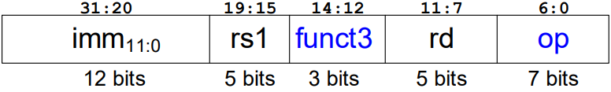
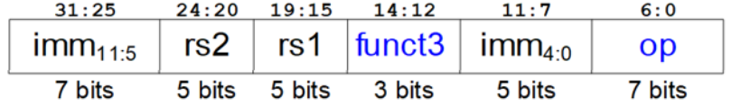
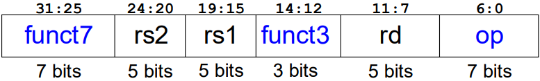
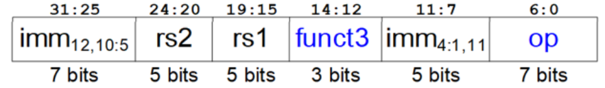
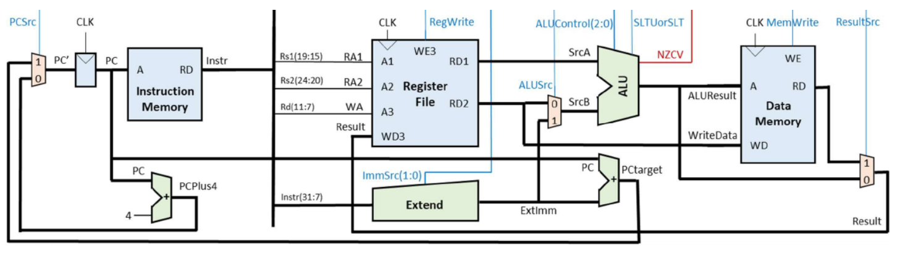
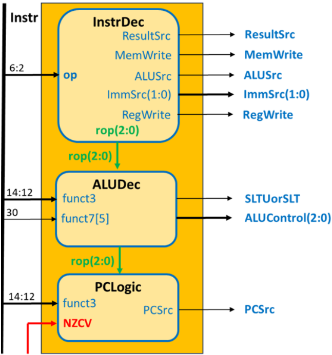
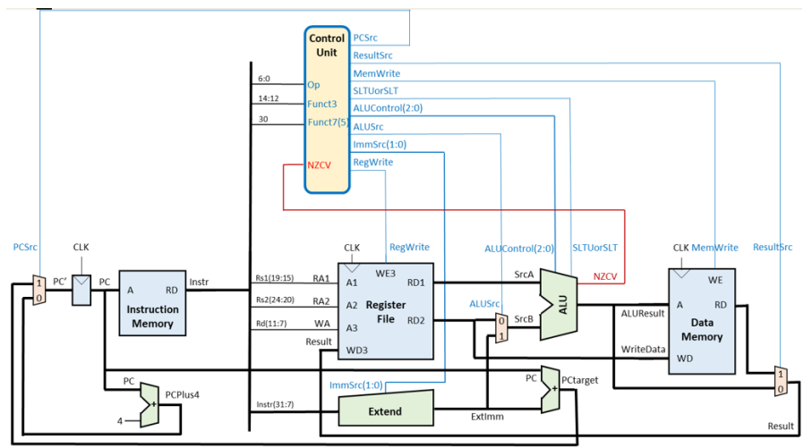

# Single-cycle RISC-V Processor

Below are provided the details of the disign of the architecture and the microarchitecture of a single-cycle RISC-V processor. Specifically, the covered fields include the implemented instructions, the datapath and the control unit of the processor.

## Instructions Implemented

### Memory Access

`LW`: 

`SW`: 

### Data Processing

#### R-Type
`ADD`, `SUB`, `OR`, `XOR`, `SLT`, `SLTU`:

#### I-Type
`ADD-I`, `AND-I`, `OR-I`, `XOR-I`:

### Branch
`BEQ`, `BNE`:

## Datapath

## Control Unit

### Structure

### Instruction Decoder Truth Table
| Instruction | op(6:2) | rop(2:0) | ResultSrc | MemWrite | ALUSrc | ImmSrc(1:0) | RegWrite |
| :--- | :---: | :---: | :---: | :---: | :---: | :---: | :---: |
| **LW** | 00000 | 000 | 1 | 0 | 1 | 00 | 1 |
| **SW** | 01000 | 001 | 0 | 1 | 1 | 01 | 0 |
| **ALU-R** | 01100 | 010 | 0 | 0 | 0 | 00 | 1 |
| **ALU-I** | 00100 | 011 | 0 | 0 | 1 | 00 | 1 |
| **Branch** | 11000 | 100 | 0 | 0 | 0 | 10 | 0 |

### ALU Decoder Truth Table
| Instruction | op(6:0) | rop(2:0) | funct3 | funct7[5] | ALU Operation | ALUControl | SLTUorSLT |
| :--- | :---: | :---: | :---: | :---: | :---: | :---: | :---: |
| **ADD** | 0110011 | 010 | 000 | 0 | add | 000 | X |
| **SUB** | 0110011 | 010 | 000 | 1 | sub | 001 | X |
| **OR** | 0110011 | 010 | 110 | 0 | or | 101 | X |
| **XOR** | 0110011 | 010 | 100 | 0 | xor | 110 | X |
| **SLT** | 0110011 | 010 | 010 | 0 | slt | 010 | 0 |
| **SLTU** | 0110011 | 010 | 011 | 0 | sltu | 010 | 1 |
| **ADDI** | 0010011 | 011 | 000 | X | add | 000 | X |
| **ANDI** | 0010011 | 011 | 111 | X | and | 100 | X |
| **ORI** | 0010011 | 011 | 110 | X | or | 101 | X |
| **XORI** | 0010011 | 011 | 100 | X | xor | 110 | X |
| **LW** | 0000011 | 000 | 010 | X | add | 000 | X |
| **SW** | 0100011 | 001 | 010 | X | add | 000 | X |
| **BEQ** | 1100011 | 100 | 000 | X | sub | 001 | X |
| **BNE** | 1100011 | 100 | 001 | X | sub | 001 | X |

### PC Logic Truth Table
| Instruction | op(6:0) | rop(2:0) | funct3 | NZCV | PCRsc |
| :--- | :---: | :---: | :---: | :---: | :---: |
| **BEQ** | 1100011 | 100 | 000 | X0XX | 0 |
| **BEQ** | 1100011 | 100 | 000 | X1XX | 1 |
| **BNE** | 1100011 | 100 | 001 | X0XX | 1 |
| **BNE** | 1100011 | 100 | 001 | X1XX | 0 |
| **LW** | 0000011 | 000 | XXX | XXXX | 0 |
| **SW** | 0100011 | 001 | XXX | XXXX | 0 |
| **ALU-R** | 0110011 | 010 | XXX | XXXX | 0 |
| **ALU-I** | 0010011 | 011 | XXX | XXXX | 0 |

## RISC-V Processor
